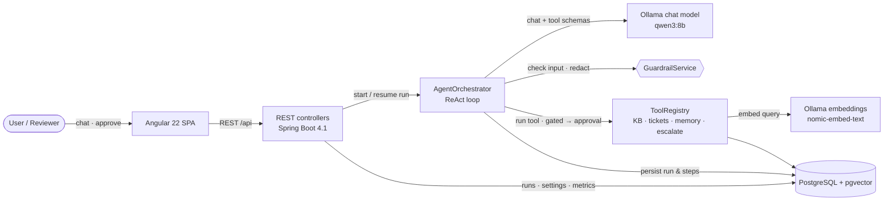

# DeskPilot

[](https://github.com/smayros-dev/deskPilot/actions/workflows/ci.yml)

**An AI copilot for the IT helpdesk that runs fully on your machine.** DeskPilot answers questions from a knowledge base, opens tickets, and remembers each user's setup. A human approves every risky action before it runs.

Built with **Angular** + **Spring Boot** + **Spring AI**, on a **free local model served by [Ollama](https://ollama.com)**. No paid API and no data leaves your machine.

> The step-by-step implementation plan and its progress live in [`steps.md`](steps.md).

## Features

- **ReAct agent loop**: the model reasons, calls tools, observes results and repeats, within a configurable step budget.
- **Agentic RAG with hybrid search**: articles in PostgreSQL are ranked both semantically (pgvector) and by keywords (full-text search), merged with Reciprocal Rank Fusion. The agent decides when to search and rephrases when results aren't relevant.
- **Human in the loop**: tools marked `@RequiresApproval` (for example `create_ticket`) pause the run until a reviewer approves or rejects it.
- **Memory**: short-term conversation memory and long-term per-user facts (which refuse secrets).
- **Guardrails**: a prompt-injection filter, redaction of passwords, API keys and card numbers, and tool-output limits.
- **Full traceability**: every thought, tool call, result and approval is stored and shown as a reasoning trace.
- **Cited answers**: answers are rendered as Markdown (safely, without raw HTML) and cite the knowledge-base articles they use as `[n]` chips, with a Sources list linking to each article.
- **User feedback**: 👍/👎 and a comment on every answer; the dashboard shows the satisfaction rate (overall and per model) and the latest negative feedback for reviewers.
- **Live progress**: answers are streamed as Server-Sent Events, so the chat shows each step (model thinking, tool calls, results) while the agent works instead of a silent wait of a minute or more.
- **Metrics dashboard**: success rate, average and p95 latency, tool accuracy, escalations and tokens, overall and per model.
- **Durable conversations**: sessions, chat memory and runs waiting for approval are stored in PostgreSQL, so a backend restart loses nothing; a paused run can still be approved afterwards.
- **Sign-in and roles**: OpenID Connect login through Keycloak (Authorization Code + PKCE). The user id comes from the token; only **reviewers** can approve actions (from their own Approvals queue) and only **admins** can change settings.
- **Tracing**: one OpenTelemetry trace per agent run, with every model and tool call as a span, viewable in Jaeger.
- **Grounding check**: when the model answers or opens a ticket without searching the knowledge base, it is sent back once to search first (measured: 64% → 84% of the evaluation scenarios).
- **Self-check**: before answering, the draft is compared with the retrieved articles (missing key facts are added); before a ticket goes to a reviewer, the model checks that the articles really require one.
- **Real-time updates**: a per-user Server-Sent Events channel (`GET /api/events`) pushes run changes to their owner, new tickets, and the number of runs waiting for approval to reviewers (live badge on the Approvals link). The chat only polls while the stream is down.
- **MCP**: DeskPilot's read-only knowledge-base tools are available to other agents and IDEs over the Model Context Protocol, and tools of external MCP servers can be given to the agent (always behind the approval gate).
- **Runtime settings**: switch the model and tune temperature, top-p, context window, thinking mode, RAG and tools from the UI, with no restart.

## Architecture



| Part | Tech | Folder |
|---|---|---|
| Backend | Spring Boot 4.1, Java 21, Spring AI 2.0, PostgreSQL + pgvector, Flyway | [`backend/`](backend) |
| Frontend | Angular 22 (standalone, signals, zoneless, `httpResource`, `@defer`) | [`frontend/`](frontend) |
| LLM | Ollama: `qwen3:8b` (chat + tools), `nomic-embed-text` (embeddings) | local |

## Project layout

```
backend/                       Spring Boot app (pl.piomin.services.deskpilot)
  agent/                       orchestrator, settings, model catalog, chat options
  agent/tool/                  @Tool classes: knowledge base, tickets, memory, escalation
  guardrail/                   input filter and output redaction
  security/                    JWT resource server, roles (user / reviewer / admin)
  controller/ service/ model/  REST API, services, JPA entities
  src/main/resources/          application.yml, Flyway migrations, system prompt, KB articles
  compose.yaml                 development containers: Postgres + pgvector, Keycloak, Jaeger (started automatically)
  Dockerfile                   layered Spring Boot image (JRE 21, non-root)
  keycloak/                    realm with roles, SPA client and demo users
frontend/                      Angular app
  src/app/chat/                chat, approval cards, model switcher
  src/app/approvals/           reviewers' approval queue
  src/app/runs/                run trace and details
  src/app/dashboard/           success metrics
  src/app/helpdesk/            tickets, knowledge base, memories
  src/app/settings/            runtime agent settings
  Dockerfile, nginx.conf       production build served by nginx, proxying the API
compose.yaml                   the whole stack in containers
.github/workflows/ci.yml       build, tests and Docker images on every push
steps.md                       implementation plan and progress
```

## Prerequisites

- Java 21+, Node 22+
- Docker (Docker Desktop / Rancher Desktop): Postgres + pgvector and Keycloak run from `backend/compose.yaml`, started automatically by Spring Boot
- [Ollama](https://ollama.com) running locally, with the models pulled:
  ```bash
  ollama pull qwen3:8b
  ollama pull nomic-embed-text
  ```

## Run

```bash
# backend → http://localhost:8080
cd backend && ./mvnw spring-boot:run

# frontend → http://localhost:4200
cd frontend && npm start
```

Open **http://localhost:4200** and sign in. The dev server proxies `/api` and `/actuator` to the backend.

### Demo users

The Keycloak realm (`backend/keycloak/deskpilot-realm.json`) is imported on first start, with these users (local demo only):

| User / password | Roles | Can |
|---|---|---|
| `alice` / `alice` | user | Chat, see own tickets and memories, read settings |
| `bob` / `bob` | user, reviewer | Also approve or reject agent actions on the **Approvals** page, see all tickets |
| `admin` / `admin` | user, reviewer, admin | Also change the agent settings and switch the model |

Keycloak's own console is at http://localhost:8180 (admin / admin). Traces are in Jaeger at http://localhost:16686 (service `deskpilot`, one trace per agent run, with the model and tool calls as spans).

> Spring Boot only runs `docker compose up` when none of the project's containers are running. If Postgres was
> already up from an earlier version, start Keycloak once with `docker compose up -d` in `backend/`.
Check `http://localhost:8080/actuator/health`. The `ollama` component reports DOWN if Ollama isn't running or a model is missing.

## Configuration

Most agent behaviour (model, sampling, context window, tools, approvals, prompt) is changed at runtime on the **Settings** page and stored in the database. To try another model, `ollama pull <name>` and pick it there; only models with tool calling are offered. The environment variables below set the **defaults** used on first start or after "Reset to defaults".

### Environment variables

| Variable | Default | Purpose |
|---|---|---|
| `OLLAMA_BASE_URL` | `http://localhost:11434` | Ollama server |
| `AGENT_CHAT_MODEL` | `qwen3:8b` | Chat/tool-calling model |
| `AGENT_EMBEDDING_MODEL` | `nomic-embed-text` | Embedding model for RAG |
| `AGENT_THINK` | `false` | qwen3 reasoning mode. About 15x slower on CPU; enable on a GPU |
| `DESKPILOT_ISSUER_URI` | `http://localhost:8180/realms/deskpilot` | OIDC issuer whose tokens the API accepts |
| `OTEL_TRACES_ENDPOINT` | `http://localhost:4318/v1/traces` | OTLP endpoint for traces (Jaeger) |
| `TRACING_EXPORT_ENABLED` | `true` | Set to `false` to stop exporting traces |

## Frontend pages

| Route | What it shows |
|---|---|
| `/chat` | Conversation with the agent, pending actions (decided here by reviewers, otherwise shown until a reviewer decides), per-answer reasoning trace |
| `/approvals` | Reviewers only: every run waiting for a decision, from all users |
| `/runs/:id` | Full trace of one run (thoughts, tool calls, results, approvals, tokens, timing) |
| `/dashboard` | Success metrics: task success, latency (avg/p95), tool accuracy, escalations, approvals, tokens |
| `/helpdesk/tickets` · `/knowledge` · `/memories` | Tickets (own, or all for reviewers), KB articles, long-term memories of the signed-in user |
| `/settings` | Agent configuration (read-only unless admin): model, temperature, top-p, context window, max tokens, thinking, max steps, RAG, tools & approvals, system prompt |

## Run everything in Docker

The root `compose.yaml` builds and starts the whole stack: Postgres + pgvector, Keycloak, Jaeger, the backend and the
frontend (nginx, which also proxies `/api` and streams Server-Sent Events).

```bash
docker compose up --build        # then open http://localhost:4200
```

By default the backend uses the Ollama already running on your machine (`host.docker.internal:11434`), which is the
fastest option and can use your GPU. Ollama must then accept connections from containers: by default it listens on
`127.0.0.1` only, which containers cannot reach (on Windows with Rancher Desktop or WSL, for example). Either start Ollama
with `OLLAMA_HOST=0.0.0.0` (it is then reachable from your network too — keep the firewall on), or run Ollama in a
container as well (pulls `qwen3:8b` and `nomic-embed-text` on first start, CPU only):

```bash
OLLAMA_BASE_URL=http://ollama:11434 docker compose --profile ollama up --build
```

The stack uses the same ports as the development setup (4200, 8080, 8180, 16686), so stop one before starting the other
(`docker compose down` in `backend/` for the development containers).

## Evaluation

The **Evaluation** page (admins) runs 25 scripted helpdesk scenarios ([`eval/scenarios.json`](backend/src/main/resources/eval/scenarios.json))
through the real agent with a chosen model and scores each answer: expected outcome (answered, approval requested,
escalated, blocked), tools that must and must not be called, facts the answer must mention and text it must not contain.
Use it to compare models, prompts and settings on the same requests before changing the live agent. Ticket requests are
checked at the approval step and never created; evaluation runs do not count in the dashboard.

### Results (qwen3:8b on CPU, 2026-10-20)

| Version | Score | Knowledge | Tickets | Escalation | Avg / p95 latency |
|---|---|---|---|---|---|
| Baseline (prompt v1) | 16/25 (64%) | 6/13 | 3/4 | 1/2 | 25 s / 52 s |
| Prompt v2 (19 scenarios) | 13/19 (baseline: 10/19) | 8/13 | 3/4 | 2/2 | — |
| + grounding check for answers (19 scenarios) | 16/19 | 11/13 | 3/4 | 2/2 | — |
| + grounding check for tickets | **21/25 (84%)** | 10/13 | 3/4 | 2/2 | 44 s / 71 s |
| + refined ticket reminder (ticket scenarios) | — | — | **4/4** | — | — |
| + hybrid search (knowledge scenarios) | — | **11/13** | — | — | 62 s / — |
| + self-check (knowledge + ticket scenarios) | — | **12/13** | **4/4** | — | ~110 s* / — |

What the evaluation found and what fixed it:
- **The model answered from general knowledge** in 7 of 13 knowledge questions: no search, invented procedures
  ("12 characters" instead of 14, a guest Wi-Fi without password) and copied the prompt's example citation `[4]`.
  Prompt v2 (no literal example, "search even if you think you know") helped a little; the **grounding check** — when a
  turn ends without any tool call, the model is reminded once to search — fixed most of it.
- **Tickets were opened without looking up the procedure**: wrong priority for a lost phone (HIGH instead of CRITICAL),
  a ticket for a mouse that the IT desk hands out. The grounding check also sends back a `create_ticket` requested
  before any search, once per turn.
- **Cost**: one extra model call when a check fires, so the average latency rose from 25 s to 44 s on CPU. The check
  can be switched off on the Settings page.
- **Retrieval gaps** ("install visual studio code", "broken mouse" found no article above the similarity threshold)
  were fixed by **hybrid search** (12c): both questions now retrieve the right article.
- **Self-check** (12g) fixed the unnecessary ticket for a mouse: the articles say accessories are handed out at the IT
  desk, so the ticket is sent back before it reaches a reviewer.
- **Left**: one answer (account locked) suggests a password reset instead of waiting 30 minutes; the self-check judged
  it acceptable. *Latency of the last run inflated by other builds running on the same machine.
  `gemma4:26b` was not compared: far too slow on this CPU.

## MCP (Model Context Protocol)

- **DeskPilot as an MCP server**: `http://localhost:8080/mcp` (Streamable HTTP) exposes `search_knowledge_base` and
  `get_knowledge_article`, read-only, to other agents and IDEs. Send `Authorization: Bearer <access token>` from Keycloak,
  for a user with the `user` role. Tools that change data (tickets, memories, escalation) are not exposed.
- **External MCP servers**: their tools join the agent as `mcp_<server>_<tool>`, always need a reviewer's approval, and
  never receive user or run data. They appear on the Settings page with an "MCP" badge. Example:

  ```yaml
  spring:
    ai:
      mcp:
        client:
          streamable-http:
            connections:
              github:
                url: https://api.githubcopilot.com
                endpoint: /mcp/
  ```

  Stdio servers work too (`spring.ai.mcp.client.stdio.connections.<name>.command/args/env`). Servers that need an auth
  header (e.g. a GitHub token) are not supported yet.

## CI

[`.github/workflows/ci.yml`](.github/workflows/ci.yml) runs on every push and pull request: backend build and tests
(Testcontainers starts Postgres on the runner), frontend tests and production build, then builds both Docker images.

## Tests

```bash
cd frontend && npx ng test --watch=false   # Vitest component/service tests
cd backend && ./mvnw test                  # unit + integration tests on Postgres via Testcontainers (Docker needed, no Ollama)
OLLAMA_IT=true ./mvnw test -Dtest="*SmokeTest"   # real local model: chat, RAG, full agent runs (slow on CPU)
```

## REST API

| Method | Path | Purpose |
|---|---|---|
| `POST` | `/api/sessions` | Start a conversation for the signed-in user |
| `POST` | `/api/sessions/{id}/messages` | Ask the agent (`{"message": "..."}`) → run with trace |
| `POST` | `/api/sessions/{id}/messages/stream` | Same, as `text/event-stream`: `run`, `thinking`, `step`… then `done` (final run) or `error` (Problem Detail) |
| `GET` | `/api/sessions/{id}/runs` | Conversation history |
| `GET` | `/api/runs/{id}` | One run with its steps |
| `GET` | `/api/events` | Live updates as Server-Sent Events: `run` (your runs), `ticket` (your tickets; all for reviewers), `approvals` (`{"pending": n}`, reviewers) |
| `GET` | `/api/runs` | Reviewers: runs waiting for approval, oldest first |
| `PUT` `DELETE` | `/api/runs/{id}/feedback` | Owner: rate a finished answer (`{"rating": "UP"|"DOWN", "comment": "..."}`) or remove the rating |
| `GET` | `/api/feedback?rating=DOWN` | Reviewers: latest negative feedback |
| `GET` `POST` | `/api/evaluations`, `/api/evaluations/{id}`, `/api/evaluations/scenarios`, `POST /api/evaluations/{id}/cancel` | Admins: run and compare evaluations |
| `POST` | `/api/runs/{id}/approval` | Reviewers: approve/reject a paused tool call (`{"approved": true, "comment": "..."}`) |
| `POST` | `/api/runs/{id}/approval/stream` | Same, streaming the resumed run as Server-Sent Events |
| `GET` | `/api/tickets`, `/api/me/memories`, `/api/knowledge-base/articles` | Agent data (tickets: own, or all for reviewers) |
| `GET` | `/api/metrics` | Success metrics (success rate, latency, tool accuracy, escalations…), also per model |
| `GET` `PUT` `DELETE` | `/api/settings` | Read / change / reset the runtime agent settings (applied from the next request) |
| `GET` | `/api/models`, `/api/tools` | Installed Ollama models with capabilities; available tools |

Every `/api` call needs `Authorization: Bearer <access token>` from Keycloak (401 without, 403 without the role). Other users' sessions, runs and tickets answer 404. `PUT`/`DELETE /api/settings` need the admin role.

Errors are RFC 9457 Problem Details (400 validation, 404, 409 conflicting state, 422 guardrail, 502 model down).

## Changelog

- **1.0.16** — Self-check of answers and tickets (12g, Flyway V10); real-time updates over a per-user SSE channel with a live approval badge (12k); MCP server for the knowledge base and MCP client for external tools behind the approval gate (12i).
- **1.0.15** — Hybrid search (12c): Postgres full-text ranking merged with pgvector by Reciprocal Rank Fusion (Flyway V7), Settings toggle; knowledge scenarios 10/13 → 11/13.
- **1.0.14** — Step 10 results: prompt v2 and the grounding check (answers and tickets, Settings toggle, Flyway V6); qwen3:8b from 64% to 84% of the scenarios.
- **1.0.13** — Cited answers with safe Markdown rendering (12a); 👍/👎 feedback on answers with satisfaction metrics (12l).
- **1.0.12** — Evaluation: 25 scenarios, background runner with deterministic scoring, admin Evaluation page comparing models; evaluation runs kept out of the live metrics; bounded Spring AI retry so an unreachable model fails in seconds.
- **1.0.11** — Delivery: Dockerfiles (layered backend image, nginx frontend with SSE proxying), full-stack `compose.yaml` (optional Ollama container), GitHub Actions CI, OpenTelemetry tracing to Jaeger (one trace per run, model and tool spans).
- **1.0.10** — Streaming: Server-Sent Events endpoints for chat and approvals; the chat shows live steps and what the agent is doing.
- **1.0.9** — Security: Keycloak (OIDC, PKCE) in Docker Compose, Spring Security resource server, user id from the token, reviewer role for approvals (new Approvals page), admin role for settings, ownership checks on sessions/runs/tickets.
- **1.0.8** — Durable sessions: sessions, chat memory (Spring AI JDBC repository) and runs paused for approval stored in PostgreSQL (Flyway V3); runs interrupted by a restart are marked failed on startup.
- **1.0.7** — Project renamed to DeskPilot: Maven artifact `deskpilot`, package `pl.piomin.services.deskpilot`, UI title, Compose database `deskpilot`.
- **1.0.6** — Runtime agent settings and model switching from the UI (Settings page + chat switcher), per-model metrics.
- **1.0.5** — PostgreSQL + pgvector (Docker Compose, Flyway, Testcontainers) replaces H2 and the in-memory vector store.
- **1.0.4** — Angular frontend: chat with approvals and reasoning traces, run details, metrics dashboard, tickets/knowledge/memories pages.
- **1.0.3** — Guardrails (prompt-injection filter, secret/card redaction, tool-output limits), REST API, Micrometer metrics and `/api/metrics` success metrics.
- **1.0.2** — Tools (`@Tool` + `@RequiresApproval`), ReAct agent loop with human approval gate, run tracing; tests with a scripted model and opt-in smoke tests on qwen3.
- **1.0.1** — Domain model (runs, steps, tickets, memories, KB articles), vector-search knowledge base with seeded helpdesk articles.
- **1.0.0** — Project scaffold; Spring AI + Ollama wiring, Ollama health indicator, Problem Details error handling.
