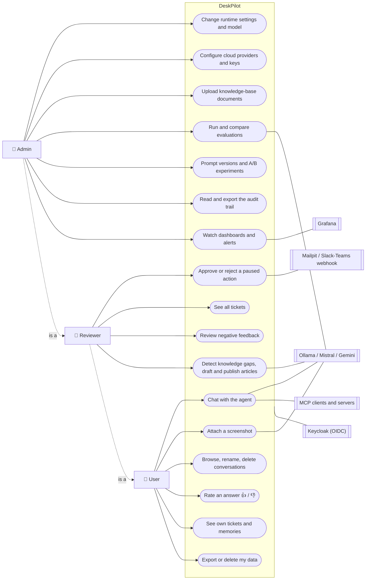
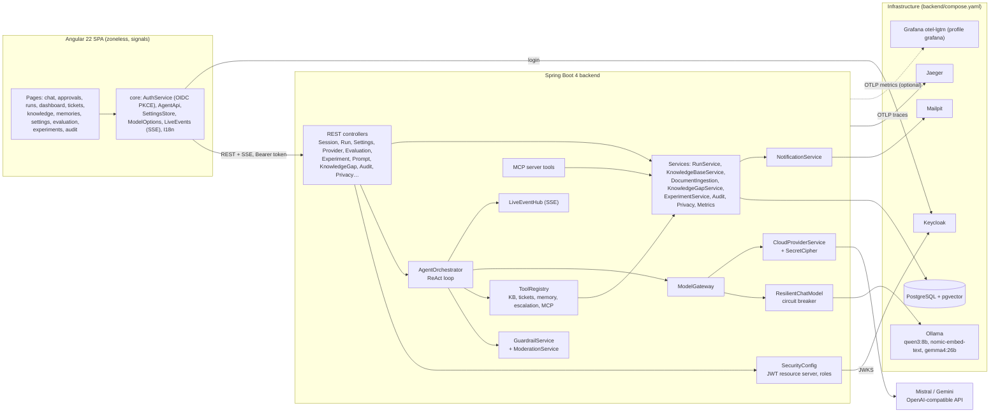
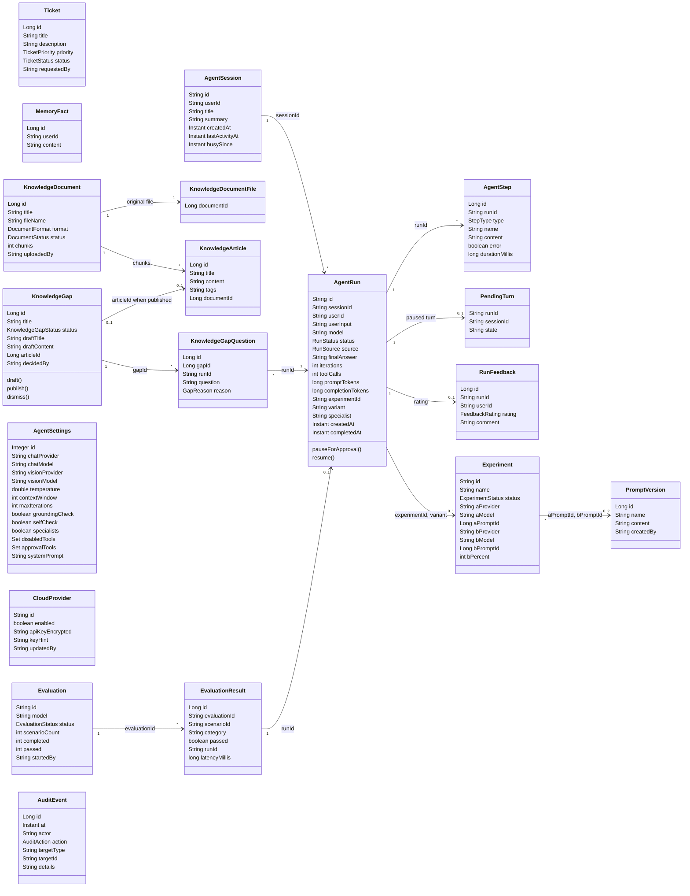
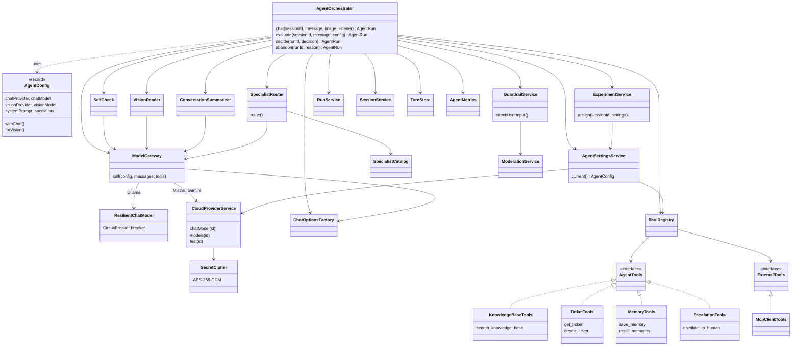
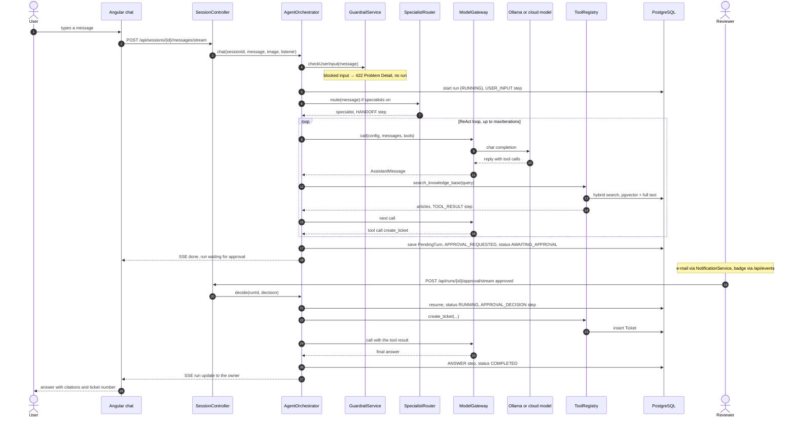
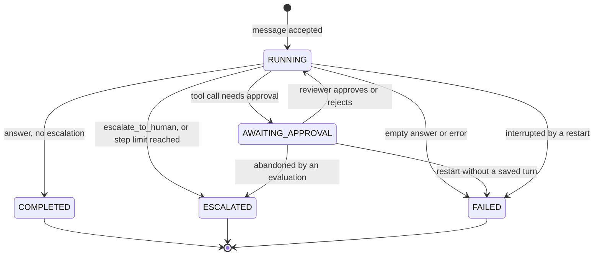
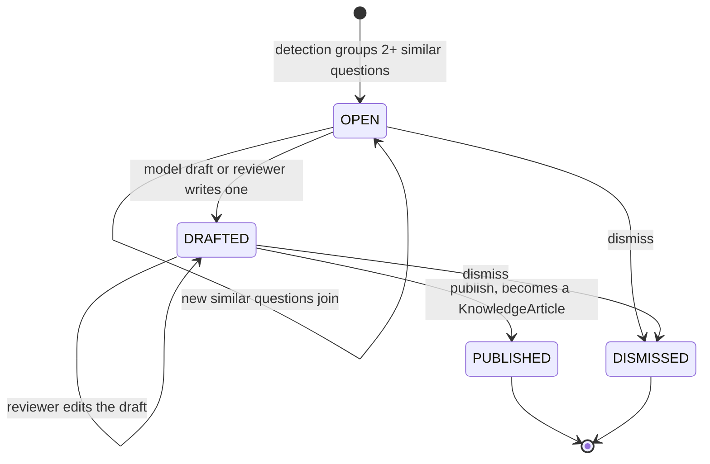

# DeskPilot — Architecture

This document describes how DeskPilot is built, with diagrams traced from the source code
(`backend/src/main/java/pl/piomin/services/deskpilot`, `frontend/src/app`). The Mermaid diagrams render directly on
GitHub; the interactive versions are listed at the end.

- [Use cases](#use-cases)
- [Components](#components)
- [Domain model (class diagram)](#domain-model)
- [Agent core (class diagram)](#agent-core)
- [Sequence: a chat message with an approval](#sequence-chat-message-with-approval)
- [States](#states)
- [Interactive diagrams](#interactive-diagrams)

## Use cases

Three roles come from Keycloak (realm `deskpilot`): **user**, **reviewer** (also a user) and **admin** (also a user and
a reviewer). Each role adds use cases to the one before it.

Notes:
- **Sign-in**: every `/api` call carries a Keycloak access token (Authorization Code + PKCE in the browser).
- **Approvals**: tools marked `@RequiresApproval` (e.g. `create_ticket`) and every external MCP tool pause the run
  until a reviewer decides. Reviewers get an e-mail; approvals that wait longer than the SLA are escalated to admins.
- **MCP**: other agents and IDEs read the knowledge base over MCP (`/mcp`). The agent can also call tools of external
  MCP servers, always behind the approval gate.

## Components

The model behind every call is chosen at runtime: `ModelGateway` sends a call to the local Ollama `ChatModel`
(wrapped by `ResilientChatModel`) or to a cloud client built by `CloudProviderService`, depending on the provider in
`AgentConfig`. Settings are stored in the database (`agent_settings`) and apply from the next request.

## Domain model

JPA entities in `model/` (tables created by Flyway migrations V1–V20). Entities reference each other **by id** (for
example `AgentRun.sessionId`, `AgentStep.runId`); there are no JPA associations, so the links below are logical
references, not mapped relations.

```mermaid
classDiagram
    direction LR
    class RunStatus {
        <<enumeration>>
        RUNNING
        AWAITING_APPROVAL
        COMPLETED
        ESCALATED
        FAILED
    }
    class RunSource {
        <<enumeration>>
        CHAT
        EVALUATION
    }
    class StepType {
        <<enumeration>>
        USER_INPUT
        THOUGHT
        TOOL_CALL
        TOOL_RESULT
        APPROVAL_REQUESTED
        APPROVAL_DECISION
        ANSWER
        GUARDRAIL
        ERROR
        IMAGE_ANALYSIS
        HANDOFF
    }
    class KnowledgeGapStatus {
        <<enumeration>>
        OPEN
        DRAFTED
        PUBLISHED
        DISMISSED
    }
    class GapReason {
        <<enumeration>>
        ESCALATED
        TICKET
        NEGATIVE_FEEDBACK
        NOT_FOUND
    }
    class TicketStatus {
        <<enumeration>>
        OPEN
        IN_PROGRESS
        RESOLVED
        CLOSED
    }
    class TicketPriority {
        <<enumeration>>
        LOW
        MEDIUM
        HIGH
        CRITICAL
    }
    class DocumentStatus {
        <<enumeration>>
        PROCESSING
        READY
        FAILED
    }
    class DocumentFormat {
        <<enumeration>>
        PDF
        MARKDOWN
        TEXT
        HTML
    }
    class FeedbackRating {
        <<enumeration>>
        UP
        DOWN
    }
    class ExperimentStatus {
        <<enumeration>>
        RUNNING
        STOPPED
    }
    class EvaluationStatus {
        <<enumeration>>
        RUNNING
        COMPLETED
        CANCELLED
        FAILED
    }
```

`AuditAction` (26 values) groups: approvals (`APPROVAL_APPROVED`, `APPROVAL_REJECTED`), settings (`SETTINGS_CHANGED`,
`SETTINGS_RESET`), documents (`DOCUMENT_UPLOADED`, `DOCUMENT_REINDEXED`, `DOCUMENT_DELETED`), evaluations
(`EVALUATION_STARTED`, `EVALUATION_CANCELLED`), privacy (`CONVERSATION_DELETED`, `MEMORY_DELETED`, `MEMORIES_DELETED`,
`USER_DATA_EXPORTED`, `USER_DATA_DELETED`, `RETENTION_CLEANUP`), cloud providers (`PROVIDER_UPDATED`,
`PROVIDER_KEY_SET`, `PROVIDER_KEY_REMOVED`), experiments (`PROMPT_VERSION_SAVED`, `PROMPT_VERSION_DELETED`,
`EXPERIMENT_STARTED`, `EXPERIMENT_STOPPED`) and knowledge gaps (`KNOWLEDGE_GAPS_DETECTED`, `KNOWLEDGE_GAP_DRAFTED`,
`KNOWLEDGE_GAP_PUBLISHED`, `KNOWLEDGE_GAP_DISMISSED`).

## Agent core

The services that run one agent turn, with their constructor dependencies (`agent/`, `agent/tool/`,
`agent/specialist/`, `cloud/`, `guardrail/`, `service/`).

## Sequence: chat message with approval

A user asks for something that needs a ticket. The run pauses at `create_ticket` (a `@RequiresApproval` tool) until a
reviewer approves it, then continues to the final answer. Progress is streamed to the browser as Server-Sent Events.

## States

### Agent run (`RunStatus`)

From `AgentOrchestrator`, `AgentRun` and `InterruptedRunRecovery`.

- A message blocked by the input guardrail never creates a run (HTTP 422).
- Runs waiting for approval survive a restart: the paused turn is stored in `pending_turn`. Runs still `RUNNING`
  when the backend stopped are marked `FAILED` at startup.

### Knowledge gap (`KnowledgeGapStatus`)

From `KnowledgeGap` and `KnowledgeGapService`.

Publishing needs a draft (otherwise 409); acting on a published or dismissed gap returns 409.

## Interactive diagrams

Interactive versions (zoom, focus, dark/light theme, export to PNG/SVG) are standalone HTML pages. Open them locally
in a browser; GitHub shows HTML files as source.

| Diagram | File |
|---|---|
| Components / architecture | [diagrams/architecture-deskpilot-20261020-233020/deskpilot-architecture.html](diagrams/architecture-deskpilot-20261020-233020/deskpilot-architecture.html) |
| Sequence: chat message with approval | [diagrams/sequence-chat-approval-20261020-233020/chat-approval.html](diagrams/sequence-chat-approval-20261020-233020/chat-approval.html) |
| States of an agent run | [diagrams/lifecycle-agent-run-20261020-233020/agent-run.html](diagrams/lifecycle-agent-run-20261020-233020/agent-run.html) |
| Workflow of the agent loop | [diagrams/workflow-agent-loop-20261020-233020/agent-loop.html](diagrams/workflow-agent-loop-20261020-233020/agent-loop.html) |
